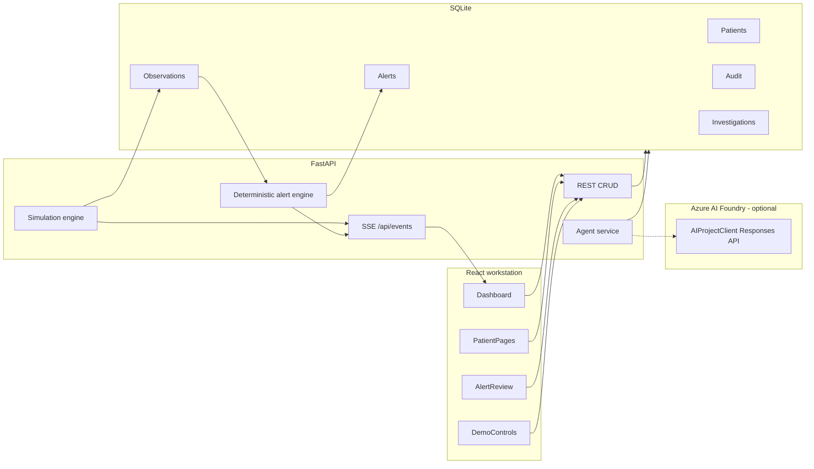

# VitalWatch AI architecture

## Runtime flow

1. The backend seeds 24 synthetic patients and historical observations.
2. The simulation loop writes new observations to SQLite on a timer.
3. Each valid observation is evaluated against illustrative demo rules.
4. New alerts are persisted; duplicate active events are coalesced.
5. SSE publishes observation and alert events to the workstation UI.
6. Clinician actions (acknowledge / escalate / resolve) are transactional and audited.
7. Azure investigation is optional, user-initiated, and never required for monitoring.

## Safety boundaries

- Alert detection is deterministic and local.
- Azure cannot create, mutate, or auto-resolve observations or alerts.
- Credentials stay on the server.
- Escalation is an internal record unless a verified notifier is added later.
